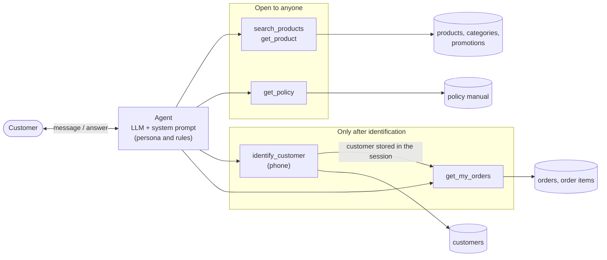

# Empório da Música: customer service agent

A prototype of a text-based customer service agent for Empório da Música, a fictional musical instrument store in
Campo Grande/MS. It is my solution to the Artefact AI Engineer technical case.

The agent should take on the store's persona, answer from the material the store provided (operational data in CSV
files and a policy manual), know when to look up data (prices, stock, order status) and when to look up policies
(returns, opening hours, payment), and handle questions outside the store's scope.

> **Status:** working prototype. See [How to run](#how-to-run) and the [example conversations](examples/).

## How I work

I usually work with Claude Code as my main assistant. It is practical for the parts of a project that need context and
iteration: researching the problem, finding a basis for decisions and shaping the solution. For quick, specific
questions, formatting or a second opinion on a prompt, I switch to other common models such as GPT, Gemini or
DeepSeek. When a project needs something more specific or experimental, I use a harness like pi and pick a model from
a provider such as OpenRouter (for example [Xiaomi MiMo](https://openrouter.ai/xiaomi/mimo-v2.6-pro)).

The assistant speeds up research, writing and code, but the problem definition, the decisions, the checking of results
and the final organisation stay with me. I need to understand and be able to defend every part of what I deliver.

## How this project is being built

I split the work into four stages, and the commit history follows them:

1. **Understanding the problem.** I read the statement and the store material, and used Claude Code to help me
   understand the problem, research examples, models and good practices, and lay out the options for each decision
   (agent approach, model and provider, interface, conversation history, data handling). I used other models for quick
   questions and to check that my prompts were well written.
2. **Skeleton.** Based on those decisions, the basic structure of the solution: folders, dependencies, configuration
   and empty modules.
3. **Development.** I built step by step: data loading, tools, prompt and interface, tested along the way, with
   small commits. Using an agent to help with repetitive tasks when necessary, but always checking and fixing the outcome.
4. **Evaluation and delivery.** Review of the whole solution, example conversations and the final README.


## Store material

The store provided six CSV tables and a policy manual, kept in `data/` as received. Before designing the agent I
checked them with pandas:
- [docs/data.md](docs/data.md): what each file holds, what the agent uses it for, and what the checks found
  (reproducible with `python scripts/audit_data.py`).
- [docs/inconsistencies.md](docs/inconsistencies.md): contradictions and gaps in the material (two phone numbers,
  conflicting instalment rules, order totals that don't match their items, a shared customer e-mail...) and the simple
  handling chosen for each one.

## The problem in one picture

The diagram is written in [Mermaid](https://mermaid.js.org/), a way of writing diagrams as text. GitHub renders it
directly, it is versioned like code, and it is easy to change by hand or with an AI assistant.



- The agent decides, at each message, whether it can answer directly, whether it needs **data** (catalogue, orders) or a
  **policy** (hours, payment, returns, shipping), or whether the question is outside the store's scope.
- Questions about the store, its products and its rules are open to anyone. Questions about a customer's own orders
  first require identification, which is checked in code.

## Technical decisions

The decisions and their justifications are recorded in [docs/decisions.md](docs/decisions.md): function calling with a
few typed tools, the policy manual as a tool, no agent framework, OpenRouter with a configurable model, customer
identification by phone, a CLI interface, in-memory history, pandas for the data and a Portuguese system prompt.

## Working with AI assistants

[AGENTS.md](AGENTS.md) holds the rules I give to coding assistants in this repository: where facts can come from, how
privacy is enforced, what must never be committed, and that every change is reviewed and committed by me.

## How to run

Requirements: Python 3.10 or later and an API key for an OpenAI-compatible endpoint (OpenRouter by default).

```bash
git clone https://github.com/felipiadenildo/emporio-da-musica-agent.git
cd emporio-da-musica-agent
python3 -m venv .venv && source .venv/bin/activate
pip install -r requirements.txt

cp .env.example .env      # then put your key in OPENAI_API_KEY
python -m emporio         # chat in the terminal; type "sair" to quit
```

Options:
- `python -m emporio --debug` prints every tool call and its result, so you can see when the agent queried data or a
  policy.
- `python -m emporio --save examples/my-conversation.md` saves the conversation.
- `python scripts/run_examples.py` runs the example conversations again and rewrites `examples/`.
- `pytest` runs the tests (no API key needed).
- `python scripts/audit_data.py` repeats the data checks.

**Model and key.** `.env.example` has the three variables the agent reads: `OPENAI_BASE_URL`, `OPENAI_API_KEY` and
`MODEL`. With OpenRouter, create a key at <https://openrouter.ai/settings/keys>; any model with tool calling works, and
the default is `anthropic/claude-haiku-5.5`. To use OpenAI directly or a local Ollama server, change the URL and the
model, as shown in the file. The key is only read from the environment and is never committed.

**Date.** Return and exchange windows depend on today's date. The agent uses the real date; `AGENT_TODAY=2026-03-25`
in `.env` fixes another date to demonstrate cases inside the windows.

## Example conversations

Five real runs of the agent, generated with `scripts/run_examples.py` (each file shows the tool calls made):

| File | Scenario |
|---|---|
| [01-catalogue-search](examples/01-catalogue-search.md) | violões up to R$ 1,000, then a follow-up filter ("which ones are electric?") |
| [02-store-info-and-out-of-scope](examples/02-store-info-and-out-of-scope.md) | address and Saturday hours from the manual, then an off-topic request |
| [03-price-promotion-and-pix](examples/03-price-promotion-and-pix.md) | a price, a product on active promotion, and why the PIX discount doesn't add up |
| [04-return-with-identification](examples/04-return-with-identification.md) | **non-trivial:** "I regret my purchase" → policy lookup → identification by phone → order dates checked against the 7-day rule → another customer's order refused |
| [05-accessories-and-stock](examples/05-accessories-and-stock.md) | accessories redirected, an out-of-stock model with alternatives, a category with no products |

I checked every price, stock level and date in these conversations against the CSV files.

## How it works

```
emporio/
  data.py      loads the CSVs with pandas (category names, specs, current price with active promotion)
  policies.py  reads the PDF manual and splits it into its 10 numbered sections
  tools.py     the five tools, the session (identified customer) and the tool schemas
  prompt.py    system prompt in Portuguese: persona, style, rules, today's date
  agent.py     the loop: model -> tool calls -> results -> model, until a text answer
  cli.py       terminal chat with --debug and --save
```

Each message goes to the model with the conversation so far and the tool definitions. If the model asks for tools, the
code runs them and sends the results back; this repeats (at most 8 rounds) until the model answers in text. Because the
identified customer is kept in the `Session` object, `get_my_orders` can only return that customer's orders.

## Assumptions

- The agent talks to customers in Brazilian Portuguese; code and documentation are in English.
- The CSV tables are the source of truth for products, prices, stock, promotions and orders; the manual for the rules.
- A customer is identified by the phone number in the customer table (see [D5](docs/decisions.md)).
- Contradictions in the material are resolved as described in [docs/inconsistencies.md](docs/inconsistencies.md), for
  example both phone numbers are given, each for its channel, and instalments follow section 3.1 of the manual.

## Known limitations

- **Authentication is simplified.** A phone number alone is weak; a real system would use the CPF plus a one-time code.
- **No real receipt date.** The 7-day return window is checked against the estimated delivery date, and the team
  confirms the request.
- **Search is literal.** It matches words in product names and categories (ignoring accents and case), with a small
  tolerance for typos. "Something for a beginner" works only because the model turns it into a category and a price.
- **The model can still phrase things imperfectly.** The facts come from tools, but the wording is generated; for
  example, in one run the agent wrote a product name slightly differently from the catalogue.
- **No memory between sessions** and no handover to a human: when the agent says it will pass a case to the team, that
  is not connected to any system.
- **Store hours are not enforced.** The agent can tell whether the store is open, but it doesn't change its behaviour
  outside business hours.

## What I would do with more time

- An evaluation set: 30 to 50 questions with expected facts, run automatically for each prompt or model change, with
  the results compared across two or three models.
- Real authentication (CPF and a one-time code) and a handover to a human with the conversation attached.
- A WhatsApp or web interface, with conversation history stored per customer (with consent, following the LGPD).
- Semantic search over product descriptions and specs, once the catalogue grows.
- Logging and tracing of tool calls, latency and cost per conversation.

## Use of AI assistants

I used **Claude Code** as my main assistant throughout the project, following the workflow described in
[How I work](#how-i-work) and the rules in [AGENTS.md](AGENTS.md):
- **Understanding and research:** it helped me read the statement and the material, find references (Anthropic's
  guide on building agents, the ReAct and τ-bench papers, the tool-calling docs of OpenAI and OpenRouter) and lay out
  the options for each decision. I made the choices recorded in [docs/decisions.md](docs/decisions.md).
- **Data audit:** it wrote the pandas checks in `scripts/audit_data.py`; I reviewed the findings and decided how to
  handle each inconsistency.
- **Code:** it drafted the modules one step at a time, following the skeleton. I reviewed, ran and committed each step
  myself.
- **Testing:** running the example conversations exposed a real bug: an out-of-stock model was reported as "not in the
  catalogue". I fixed the search so a specific model is always found and reported with its status (see the commit
  history).
- **Writing:** it helped me draft and revise this README and the docs in English.

The commit history shows the order of the work: README and method, data audit, decisions, skeleton, data loading,
tools, agent, tests, fix, examples and final documentation.
